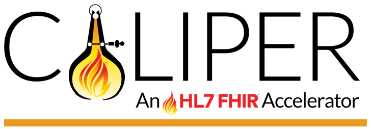

<p align="center">
  
</p>

# HL7 Caliper — Training

**Caliper** is the HL7® FHIR® Accelerator for medical and personal-health device interoperability. It advances and tests in practice the standards that let device data flow safely from the point of care into EHRs, analytics and AI — IHE SDPi, ISO/IEEE 11073 SDC and HL7 FHIR.

This repository holds the training material of the **Caliper Training Team**, for the Caliper community and the wider device-interoperability ecosystem.

## Courses

| Course | Description | Modules | Status | Contributors |
|---|---|:-:|---|---|
| [SDPi Microlearning Series](training/sdpi-microlearning/README.md) | Short, standalone 10–15 minute modules giving every stakeholder an accessible entry point into SDPi | 7 drafted · 3 planned | 🟡 Draft for review — M2a, M2b and M5 pending technical validation | Critical Software, Vector Informatik |

*Last updated: November 2026*

## Repository structure

```
caliper/
├── README.md                       ← you are here
├── CHANGELOG.md                    ← what changed, release by release
├── assets/                         ← logos used in the READMEs
└── training/
    └── sdpi-microlearning/
        ├── README.md               ← module list, status and links
        ├── module-*.md             ← modules (source of truth)
        └── docx/                   ← Word versions, generated from the Markdown
```

## How to make changes

1. **Edit the Markdown.** The `.md` modules are the source of truth — never edit the `.docx` files directly.
2. **Regenerate the Word file** from the updated Markdown and replace it in `docx/`.
3. **Update the status** of the module in the course `README.md` if it changed.
4. **Add a line to [CHANGELOG.md](CHANGELOG.md)** under *Unreleased*.
5. **Open a pull request** with a short description of what changed and why.

Found a problem but don't want to edit? [Open an issue](https://github.com/HL7/caliper/issues) naming the module and section.

## Contributors

<p>
  <a href="https://www.criticalsoftware.com"></a>
  &nbsp;&nbsp;&nbsp;&nbsp;
  <a href="https://www.vector.com"></a>
</p>

## Contact

Caliper mailing list: <https://lists.hl7.org/wws/info/caliper-accelerator>

---

<sub>HL7® and FHIR® are registered trademarks of Health Level Seven International.</sub>
